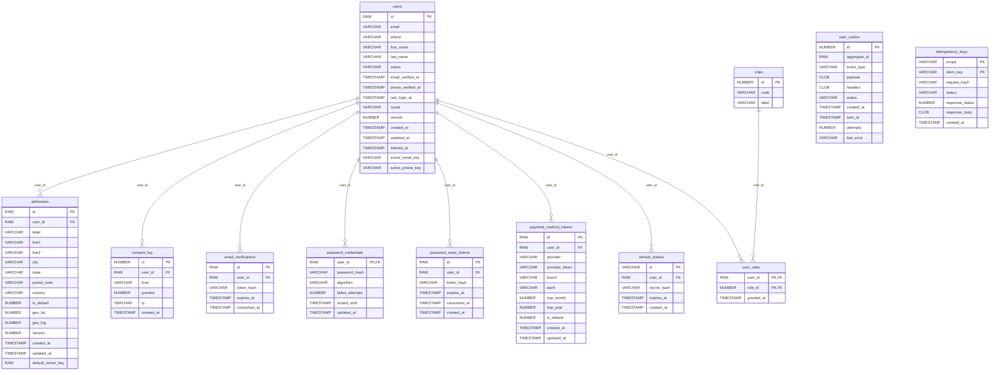

# ShopTrail User Service

Identity and access for ShopTrail: accounts, sign-in with JWT, profile, addresses, saved payment methods, consent, roles, and the account emails.

Part of **ShopTrail**, a multi-seller marketplace. Full system reference: [`marketplace_tdd.md`](https://github.com/RaghuMHulkoti/shoptrail/blob/main/docs/marketplace_tdd.md).

| | |
|---|---|
| Live | https://user-service-xy69.onrender.com |
| Swagger UI | https://user-service-xy69.onrender.com/swagger-ui.html |
| Health | https://user-service-xy69.onrender.com/actuator/health |
| Local port | `8081` |
| Database | Oracle Autonomous DB, schema `USERS` (Flyway) |
| Stack | Java 25, Spring Boot 4.1, Spring Data JPA, Flyway, Spring Security (OAuth2 resource server, Nimbus JWT), Spring Kafka, optional Redis |

## Responsibilities

- Register, verify email, sign in, refresh and sign out (RS256 access tokens, rotating refresh tokens).
- Profile, delivery addresses, saved payment-provider tokens (never card numbers), consent with history.
- Roles (`CUSTOMER`, `SUPPLIER`, `OPS`, `ADMIN`) and admin actions: list, suspend, reactivate, set roles.
- Emails: welcome, email verification, password reset, order confirmation (Brevo).
- Publishes `/.well-known/jwks.json` so other services can verify tokens.
- Serves the **ShopTrail Accounts** test console at `/console.html`. It exists only to exercise the API from a browser; a dedicated frontend has not been built yet.

## How it fits

- The order console and the seller portal sign in against this service.
- It listens to `domain.order.events` and mails the customer on `ORDER_CONFIRMED`.
- It publishes its own events to `domain.user.events`.

## Run locally

Prerequisites: JDK 25+, Maven wrapper (included), the Oracle wallet of the shared database; Redis is optional.

```bash
export DB_PASSWORD=...                       # Oracle password (never commit it)
export WALLET_DIR=/path/to/Wallet_ECOMMERCE  # unzipped Oracle wallet
./mvnw spring-boot:run
```

Add `SPRING_PROFILES_ACTIVE=dev` locally to print verification and reset tokens to the log. Never enable `dev` in production.

Create a stable key pair (otherwise every restart signs everyone out):

```bash
openssl genpkey -algorithm RSA -pkeyopt rsa_keygen_bits:2048 -out private.pem
openssl rsa -pubout -in private.pem -out public.pem
export JWT_PRIVATE_KEY_LOCATION=file:private.pem JWT_PUBLIC_KEY_LOCATION=file:public.pem
```

Open http://localhost:8081/swagger-ui.html.

### Tests

```bash
./mvnw test
```

Unit tests need nothing. `OraclePersistenceTest`, `OracleRefreshTokenStoreTest` and `UserFlowIntegrationTest` run the real migrations on H2 in Oracle mode; no Redis or database needed.

### Docker

```bash
docker build -t shoptrail-user-service .
docker run -p 8081:8081 -e DB_PASSWORD=... -e WALLET_CWALLET_B64="$(base64 < cwallet.sso)" shoptrail-user-service
```

`docker-entrypoint.sh` unpacks the wallet from `WALLET_CWALLET_B64` when it is set.

## Configuration

All settings come from environment variables. Secrets have no defaults and must never be committed.

| Variable | Default | Purpose |
|---|---|---|
| `DB_URL` | wallet URL for `ecommerce_tp` | Full JDBC URL (overrides the wallet URL) |
| `DB_USERNAME` | `ADMIN` | Oracle user |
| `DB_PASSWORD` | _(none, secret)_ | Oracle password. Required, no default |
| `REDIS_HOST` | `localhost` | Redis host (optional: rate limits and profile cache fail open without it) |
| `REDIS_PORT` | `6379` | Redis port |
| `KAFKA_BOOTSTRAP_SERVERS` | `production-fgivv4.eu.cluster.ntail.io:9092` | Kafka cluster address |
| `KAFKA_SECURITY_PROTOCOL` | `SASL_SSL` | `SASL_SSL` for the cloud cluster, `PLAINTEXT` for a local broker |
| `KAFKA_USERNAME` | `default` | SASL/PLAIN user |
| `KAFKA_PASSWORD` | _(none, secret)_ | SASL/PLAIN password. Secret |
| `CORS_ALLOWED_ORIGINS` | _(empty)_ | Comma-separated browser origins allowed to call the API. Empty = none. No trailing dot or slash |
| `SERVER_PORT` | `8081` | HTTP port |
| `REDIS_HEALTH_ENABLED` | `false` | Include Redis in `/actuator/health` |
| `REFRESH_TOKEN_STORE` | `oracle` | `oracle` or `redis` |
| `JWT_ISSUER` | `http://user-service` | `iss` claim of issued tokens |
| `JWT_PRIVATE_KEY_LOCATION` | _(empty)_ | Private key PEM, e.g. `file:/etc/secrets/private.pem`. Empty = new key at every start |
| `JWT_PUBLIC_KEY_LOCATION` | _(empty)_ | Public key PEM, e.g. `file:/etc/secrets/public.pem` |
| `JWT_KEY_ID` | `user-service-key-1` | `kid` published in the JWKS |
| `INTERNAL_SERVICE_TOKEN` | `change-me-internal-token` (replace it) | Shared secret for `/api/v1/internal/**`. Always set your own |
| `EVENTS_PUBLISHER` | `log` | `log` prints events; `kafka` publishes them |
| `EVENTS_CONSUMER_ENABLED` | `false` | `true` starts the Kafka listeners |
| `MAIL_PROVIDER` | `log` | `log` prints mails; `brevo` sends them |
| `MAIL_FROM_ADDRESS` | _(empty)_ | Sender address, verified in Brevo |
| `MAIL_FROM_NAME` | `ShopTrail` | Sender display name |
| `BREVO_API_KEY` | _(none, secret)_ | Brevo transactional email API key. Secret |
| `PUBLIC_BASE_URL` | `http://localhost:8081` | Public address of this service; mail links open `<url>/console.html` |
| `SPRING_PROFILES_ACTIVE` | _(none)_ | `dev` prints one-time tokens to the log. Local only |
| `WALLET_CWALLET_B64` | _(empty)_ | Base64 of `cwallet.sso` for containers |

## API

Errors use one shape: `{"error": {"code", "message", "details", "traceId"}}`. A replayed `Idempotency-Key` returns the first response with header `Idempotent-Replayed: true`; the same key with a different body returns 422.

| Method | Path | Auth | Purpose |
|---|---|---|---|
| POST | `/api/v1/users/register` | public, `Idempotency-Key` | Create account (status PENDING_VERIFICATION, role CUSTOMER) |
| POST | `/api/v1/users/verify-email` | public | Confirm email with token |
| POST | `/api/v1/users/verify-email/resend` | JWT | New verification token and mail |
| POST | `/api/v1/users/login` | public | Access and refresh token |
| POST | `/api/v1/users/refresh` | public | Rotate tokens |
| POST | `/api/v1/users/logout` | JWT | Revoke this or all sessions |
| POST | `/api/v1/users/password/reset-request` | public | Start password reset |
| POST | `/api/v1/users/password/reset` | public | Finish password reset |
| GET | `/api/v1/users/me` | JWT | Profile |
| PATCH | `/api/v1/users/me` | JWT | Update profile (send `version`) |
| DELETE | `/api/v1/users/me` | JWT | Delete account |
| POST | `/api/v1/users/me/password` | JWT | Change password |
| GET | `/api/v1/users/me/addresses` | JWT | List addresses |
| POST | `/api/v1/users/me/addresses` | JWT, `Idempotency-Key` | Add address |
| PATCH | `/api/v1/users/me/addresses/{id}` | JWT | Update address / make default |
| DELETE | `/api/v1/users/me/addresses/{id}` | JWT | Delete address |
| GET | `/api/v1/users/me/payment-methods` | JWT | List saved PSP tokens |
| POST | `/api/v1/users/me/payment-methods` | JWT, `Idempotency-Key` | Save PSP token |
| POST | `/api/v1/users/me/payment-methods/{id}/default` | JWT | Make default |
| DELETE | `/api/v1/users/me/payment-methods/{id}` | JWT | Remove |
| GET | `/api/v1/users/me/consents` | JWT | Current consent per kind |
| POST | `/api/v1/users/me/consents` | JWT | Record a consent decision |
| GET | `/api/v1/users/me/consents/history` | JWT | All consent decisions |
| GET | `/api/v1/admin/users` | ADMIN/OPS | Page of users, `?status=&page=&size=` |
| PUT | `/api/v1/admin/users/{id}/roles` | ADMIN/OPS | Replace roles |
| POST | `/api/v1/admin/users/{id}/suspend` | ADMIN/OPS | Suspend |
| POST | `/api/v1/admin/users/{id}/reactivate` | ADMIN/OPS | Reactivate |
| GET | `/api/v1/internal/users/{id}` | internal token | User lookup for other services |
| GET | `/.well-known/jwks.json` | public | Public signing keys |
| GET | `/console.html` | public | Account console |

## Data model

Schema `USERS`. Full columns and constraints: [section 8 of the reference](https://github.com/RaghuMHulkoti/shoptrail/blob/main/docs/marketplace_tdd.md#8-data-model).



| Table | Holds | Created in |
|---|---|---|
| `users` | Accounts, status, soft delete | `V1__init_users_schema.sql` |
| `password_credentials` | BCrypt hash, failed attempts, lockout | `V1__init_users_schema.sql` |
| `roles` | Role catalogue | `V1__init_users_schema.sql` |
| `user_roles` | Roles per user | `V1__init_users_schema.sql` |
| `addresses` | Delivery addresses, one default per user | `V1__init_users_schema.sql` |
| `payment_method_tokens` | PSP tokens and card display data | `V1__init_users_schema.sql` |
| `email_verifications` | Verification token hashes | `V1__init_users_schema.sql` |
| `consent_log` | Every consent decision | `V1__init_users_schema.sql` |
| `user_outbox` | Events waiting to be mailed and published | `V1__init_users_schema.sql` |
| `password_reset_tokens` | Reset token hashes | `V2__auth_support_tables.sql` |
| `idempotency_keys` | Stored responses for idempotent requests | `V2__auth_support_tables.sql` |
| `refresh_tokens` | Refresh token hashes (one row per session) | `V3__refresh_tokens.sql` |

## Events

**Publishes** to `domain.user.events` (keyed by user id): `USER_REGISTERED`, `USER_UPDATED`, `USER_DELETED`, `ADDRESS_UPDATED`, `EMAIL_VERIFICATION_REQUESTED`, `PASSWORD_RESET_REQUESTED`, `PASSWORD_CHANGED`.

**Consumes** `domain.order.events` (group `user-service`, starts at the latest offset): `ORDER_CONFIRMED` sends the confirmation mail. Other order events are ignored.

The outbox poller sends the matching email just before it publishes an event, with the same retry rules: a provider rejection marks the row `FAILED`, any other failure retries on the next poll.

## Background jobs

| Job | Schedule | Does |
|---|---|---|
| `OutboxPoller` | every 1 s | Mails and publishes pending `user_outbox` rows |
| `HousekeepingJob` | hourly at :15 | Deletes expired tokens, old idempotency keys, expired refresh tokens and sent outbox rows older than 7 days |

## How it works

- **Passwords:** BCrypt (strength 12). At least 12 characters with three of lower, upper, digit, symbol. 5 wrong passwords lock the account for 15 minutes.
- **Tokens:** access token is an RS256 JWT (15 min) with `sub`, `roles`, `tenantId`, `iss`, `jti`. Refresh token is `<jti>.<secret>` (30 days); only a SHA-256 hash is stored. Each refresh consumes the old token; reusing it is refused.
- **Password change or reset** revokes every refresh token of the user.
- **One-time tokens** (verify 24 h, reset 30 min) are stored as hashes; mails link to `console.html?verify=` or `?reset=`.
- **Rate limits** (login per IP and account, reset per account) and the **profile cache** use Redis and are skipped when Redis is down.
- **Account delete** erases personal data, signs the user out and publishes `USER_DELETED`.
- **First admin:** registration always grants `CUSTOMER`. Grant the first admin in SQL, then use the Admin tab:

```sql
INSERT INTO USERS.user_roles (user_id, role_id)
SELECT u.id, r.id FROM USERS.users u, USERS.roles r
WHERE LOWER(u.email) = LOWER('you@example.com') AND r.code = 'ADMIN';
```

## Deployment

- Render web service (Docker), deployed manually or with `render deploys create <service-id>`.
- Set at least: `DB_PASSWORD`, `WALLET_CWALLET_B64`, `CORS_ALLOWED_ORIGINS` (order and seller origins), `INTERNAL_SERVICE_TOKEN`, the JWT key files as Render Secret Files, the mail settings, and the Kafka settings with `EVENTS_PUBLISHER=kafka` and `EVENTS_CONSUMER_ENABLED=true`.
- CI: `.github/workflows/maven.yml` runs `mvn test`, builds the image, smoke-tests the container and pushes it to `ghcr.io`.
- Observability: `/actuator/health` (liveness and readiness probes), `/actuator/metrics`, Swagger at `/swagger-ui.html`.

## Known gaps

- No Redis in production, so rate limits are off.
- At-least-once Kafka delivery can send an order mail twice.
- No OAuth2 authorization-code flow, MFA, CAPTCHA or breached-password check.
- Other services do not verify the JWT yet; they trust `X-User-Id`.
